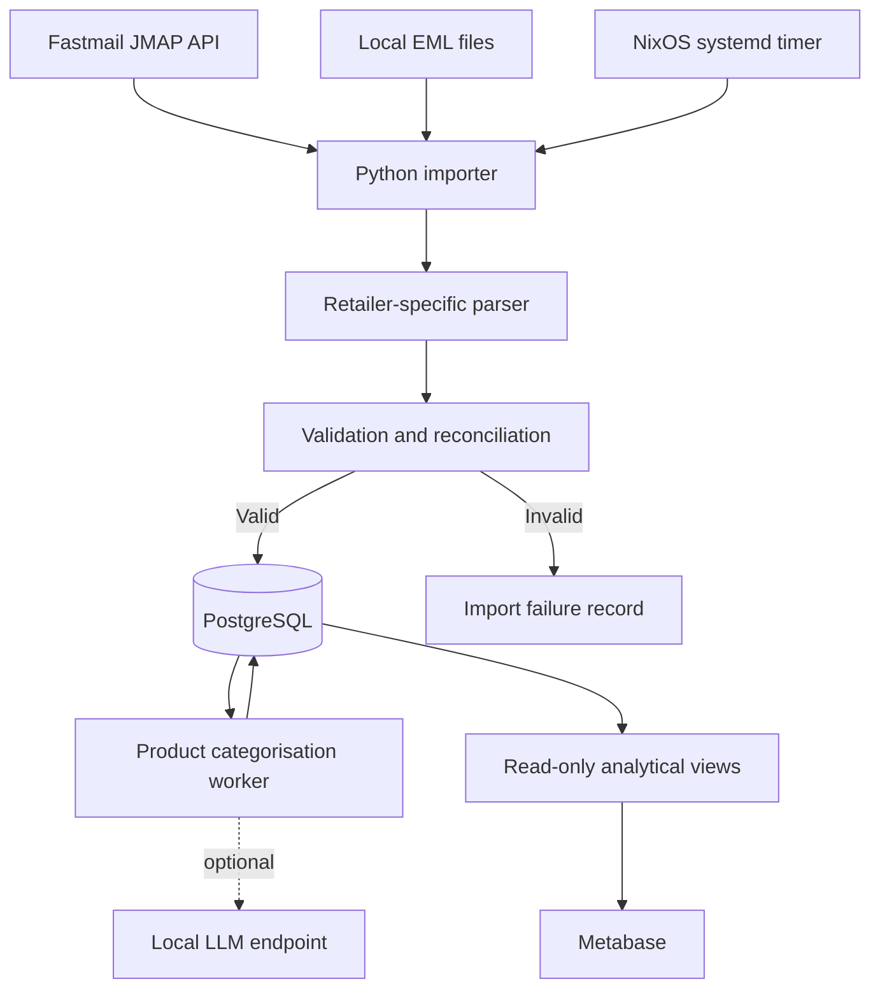
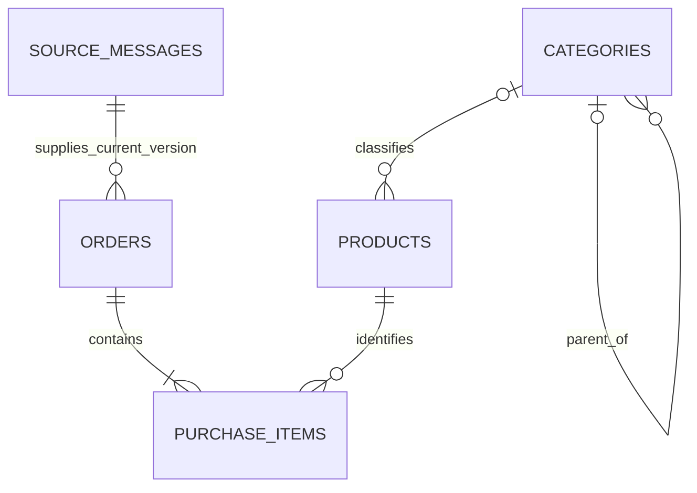

# Household Purchases — Implementation Plan

## 1. Objective

Build a small, self-hosted service that automatically imports itemised purchase emails into a relational database and makes household spending available for long-term analysis. Start with Ocado delivery emails received through Fastmail; allow additional retailers and receipt formats to be added later without redesigning the core database.

The primary goal is **purchase and expenditure analytics**, not inventory management, meal planning, bank reconciliation or general accounting.

### Success criteria

- Import all available historical Ocado delivery-summary emails without modifying the mailbox.
- Automatically import subsequent orders on a configurable schedule.
- Record each purchased product, quantity, line cost, order date and applicable order-level charges and discounts.
- Reconcile extracted monetary values against the original email before accepting an order.
- Prevent duplicate orders and purchase lines, including when historical imports are rerun.
- Maintain a reusable product catalogue with editable categories.
- Optionally classify unfamiliar products using a local LLM; import must work when the model is unavailable.
- Provide a Metabase-compatible PostgreSQL data source with useful analytical views.
- Run unattended on NixOS, with secure credentials, clear logs, backups and recoverable failures.

## 2. Instructions for the implementation agent

Use this document as the implementation specification. Inspect the existing repository before creating files; preserve existing conventions and adapt the suggested layout where appropriate. Implement the phases sequentially, with tests and documentation alongside each phase. Prefer a small working end-to-end pipeline over speculative abstractions.

- Use Python with type annotations, Pydantic for validated parser outputs, SQLAlchemy 2.x, Alembic, PostgreSQL, BeautifulSoup and httpx.
- Use pytest for tests. Prefer reproducible dependencies and a Nix flake/dev shell consistent with the repository's existing approach.
- Use explicit transactions, database constraints and integer pence for stored GBP amounts. Use `Decimal` when converting monetary text; never use binary floating point for money.
- Verify current JMAP, NixOS/nixpkgs and Metabase documentation before implementing integration details. The deployment's pinned nixpkgs revision is authoritative for NixOS options.
- Do not require live Fastmail, PostgreSQL credentials or a running LLM for parser unit tests. Mock remote API calls; use a separate PostgreSQL test instance for integration tests.
- Do not commit real email exports, personal addresses, order references, access tokens or other secrets. Build sanitised fixtures that preserve the original HTML structure and representative monetary values.
- Do not invent final receipt formats, pack sizes, barcode IDs or discount allocations. Missing data should remain unknown.
- Keep the default runtime local/private. Do not create a public webhook, web UI, or externally exposed database.
- Document any deviations from this plan and unresolved source-format ambiguities in the README or a short decision log.

## 3. Source email: verified observations

The initial supplied source is an HTML MIME email titled `Your upcoming Ocado delivery`, sent by `noreply@email.ocado.com`. It was sent on 18 November 2026 and refers to a delivery that day, with an Ocado order reference in the introductory prose.

The email contains a dedicated HTML table:

```html
<table id="productTable">
  <tbody id="tableBody">
    <tr>
      <th>Product</th>
      <th>Quantity</th>
      <th>Price to pay (£)</th>
    </tr>
    <!-- One row per purchase line, with three td elements. -->
  </tbody>
</table>
```

The attached sample was decoded and parsed successfully. Verified values:

| Field | Expected value |
| --- | ---: |
| Product lines | 30 |
| Units purchased (packs/items as reported) | 34 |
| Gross product subtotal | £119.26 |
| Offers savings | £26.95 |
| Sum of product line costs | £92.31 |
| Delivery charge | £0.00 |
| Carrier bag charge | £0.60 |
| Small order charge | £0.00 |
| Order total | £92.91 |

Representative rows:

| Product | Quantity | Line total | Effective price per purchased unit |
| --- | ---: | ---: | ---: |
| Coca-Cola Zero Sugar | 1 | £10.00 | £10.00 |
| Kallo Organic Very Low Salt Chicken Stock Cubes | 3 | £4.20 | £1.40 |
| M&S Fusilli | 1 | £0.70 | £0.70 |
| New Covent Garden Classic Chicken Soup | 1 | £1.75 | £1.75 |
| New Covent Garden Minestrone Soup | 2 | £3.50 | £1.75 |

For this sample:

```text
Gross subtotal - offers savings = sum of product line costs
11926 - 2695 = 9231 pence

Sum of product line costs + delivery + bags + small-order charge = order total
9231 + 0 + 60 + 0 = 9291 pence
```

Therefore, the observed product prices are **extended, already-discounted line totals**, not unit prices. Do not multiply them by quantity or deduct the offers savings a second time.

### Source limitations

- This is an upcoming delivery summary, not the final receipt. The email explicitly states that a receipt will follow delivery. Initially mark these orders as `provisional`; do not claim the totals represent final bank charges.
- Obtain at least one final receipt email and examples with substitutions, unavailable products, vouchers, refunds and bag returns before implementing those formats. Final receipt support is a later phase, not a prerequisite for the first importer.
- There is no observed SKU/barcode in the product table. Names are a provisional product identity; identical names may conceal different pack sizes or product changes.
- No reliable structured weight or pack size is supplied. Quantity means the retailer's reported purchased units, not kilograms or individual items within multipacks.
- The sample has no substitutions. Its reconciliation rules are verified for this sample only. Unrecognised adjustments or layouts must be flagged, not silently ignored.

## 4. Architecture



### Technology choices

| Layer | Choice |
| --- | --- |
| Email retrieval | Fastmail JMAP over HTTPS |
| Local import | Python standard-library MIME parsing |
| HTML parsing | BeautifulSoup |
| API client | httpx |
| Data contracts | Pydantic |
| Database | PostgreSQL |
| Database access | SQLAlchemy 2.x, psycopg |
| Migrations | Alembic |
| Classification | Persistent rules and optional local OpenAI-compatible LLM (e.g. Qwen) |
| Scheduling | NixOS systemd oneshot services and timers |
| Analytics | Metabase OSS, connected with read-only credentials |
| Testing | pytest, mocked HTTP and PostgreSQL integration tests |

No message queue, Rust component, FastAPI service, custom frontend, container orchestration or workflow automation platform is required for the MVP.

## 5. Proposed repository layout

```text
household-purchases/
├── plan.md
├── README.md
├── pyproject.toml
├── flake.nix
├── flake.lock
├── alembic.ini
├── migrations/
│   └── versions/
├── src/
│   └── household_purchases/
│       ├── __init__.py
│       ├── cli.py
│       ├── config.py
│       ├── schemas.py
│       ├── db.py
│       ├── models.py
│       ├── ingestion.py
│       ├── email/
│       │   ├── __init__.py
│       │   └── fastmail.py
│       ├── parsers/
│       │   ├── __init__.py
│       │   ├── base.py
│       │   └── ocado.py
│       ├── categorisation.py
│       └── analytics/
│           └── views.sql
├── tests/
│   ├── fixtures/            # Sanitised EML samples only
│   ├── test_ocado.py
│   ├── test_fastmail.py
│   ├── test_ingestion.py
│   └── test_categorisation.py
└── nix/
    └── module.nix
```

This is a suggested structure, not a requirement to create empty modules prematurely.

## 6. Data model

Use a dedicated PostgreSQL database or schema. All timestamps should be timezone-aware; use `DATE` for local delivery dates. Default business timezone: `Europe/London`. Store monetary amounts in integer pence, with currency `GBP`. No multi-currency conversion is required for the MVP.

### `orders`

| Column | Type / constraints | Purpose |
| --- | --- | --- |
| id | bigint identity PK | Internal ID |
| retailer | text, not null | e.g. `ocado` |
| order_reference | text, not null | Retailer's order ID |
| delivery_date | date, not null | Local delivery date |
| currency | text, not null, default GBP | Currency |
| gross_subtotal_pence | bigint, nullable | Before order offers |
| offer_savings_pence | bigint, nullable | Positive savings magnitude |
| product_total_pence | bigint, not null | Sum of accepted purchase lines |
| delivery_charge_pence | bigint, nullable | Delivery charge |
| bag_charge_pence | bigint, nullable | Carrier bag charge |
| small_order_charge_pence | bigint, nullable | Small order charge |
| other_adjustments_pence | bigint, nullable | Explicitly understood signed adjustments; not a balancing plug |
| total_pence | bigint, not null | Stated order total |
| status | text, constrained | `provisional`, `final` |
| source_message_id | FK to source_messages, not null | Currently authoritative source |
| created_at, updated_at | timestamptz | Audit timestamps |

Unique constraint: `(retailer, order_reference)` for the initial single-household account. If supporting multiple retailer accounts later, extend the unique key with a stable account identifier.

### `products`

| Column | Type / constraints | Purpose |
| --- | --- | --- |
| id | bigint identity PK | Internal ID |
| retailer | text, not null | Product namespace |
| name | text, not null | Display product name |
| normalised_name | text, not null | Initial identity key |
| retailer_sku | text, nullable | Future authoritative identity |
| brand | text, nullable | Optional enrichment |
| pack_size | text, nullable | Only from reliable source data |
| category_id | FK to categories, nullable | Current classification |
| classification_method | text, nullable | `manual`, `rule`, `llm` |
| classified_at | timestamptz, nullable | Classification audit |
| first_seen, last_seen | date | Observed purchase-date bounds |

Unique constraint for MVP: `(retailer, normalised_name)`. Normalise Unicode (NFKC), collapse whitespace and casefold for matching; retain display and source names separately. Do not strip brand, numbers, variants or pack-size text. Do not automatically fuzzy-merge products. Support product aliases or stable retailer SKUs later if reliable evidence becomes available.

### `purchase_items`

| Column | Type / constraints | Purpose |
| --- | --- | --- |
| id | bigint identity PK | Internal ID |
| order_id | FK to orders, not null | Parent order |
| product_id | FK to products, not null | Product catalogue reference |
| line_number | integer, not null, > 0 | Source line index |
| source_product_name | text, not null | Original parsed product text |
| quantity | integer, not null, > 0 | Reported purchased units |
| line_total_pence | bigint, not null, >= 0 | Extended discounted price |

Unique constraint: `(order_id, line_number)`. Do not enforce one line per product per order: repeated products can legitimately occur on separate lines. Derive unit price using PostgreSQL `NUMERIC` division or Python `Decimal`, not a rounded integer stored as fact. Fractional quantities and negative refund lines should be handled in a future explicitly tested schema extension rather than coerced into this MVP.

### `categories`

| Column | Type / constraints | Purpose |
| --- | --- | --- |
| id | bigint identity PK | Internal ID |
| slug | text, unique, not null | Stable classification identifier |
| name | text, not null | Display name |
| parent_id | nullable FK to categories | Optional hierarchy |
| description | text, nullable | Guidance for rules and LLM |

Seed stable categories through a migration or a version-controlled seed command. Limit hierarchy to two levels initially. Avoid cycles and ambiguous duplicate slugs. Products may be unclassified; expose them as `Uncategorised` in analytical views.

### `source_messages`

Track all processing attempts, including failures, independently of orders.

| Column | Type / constraints | Purpose |
| --- | --- | --- |
| id | bigint identity PK | Internal ID |
| source_account | text, not null | Configured non-secret account identifier |
| remote_email_id | text, nullable | Fastmail JMAP Email ID |
| internet_message_id | text, nullable | MIME Message-ID |
| content_sha256 | text, not null | Hash of exact raw MIME bytes |
| received_at | timestamptz, nullable | Provider timestamp |
| subject | text, nullable | Source metadata |
| parser_version | text, nullable | Parser revision used |
| status | text, constrained | `pending`, `imported`, `failed`, `duplicate`, `superseded` |
| error_code, error_detail | text, nullable | Sanitised error details |
| attempt_count | integer, not null | Retry tracking |
| processed_at | timestamptz, nullable | Last processing timestamp |
| raw_storage_path | text, not null | Relative path in private raw-email archive |

Uniqueness: `(source_account, remote_email_id)` when remote ID exists and `(source_account, content_sha256)`. MIME Message-ID is useful for auditing but must not replace the order reference or raw content hash as the sole deduplication key. Store raw email bytes in a protected persistent directory using content-hash filenames, not untrusted filenames from emails.

### Relationships



For later final receipt support, introduce an order-source/version association if necessary to retain all accepted revisions. The raw archive and processing records must survive replacement of provisional order lines. Index `orders.delivery_date`, `purchase_items.order_id`, `purchase_items.product_id`, and `products.category_id` in addition to required unique indexes. Avoid speculative indexing until needed.

## 7. Email retrieval and historical import

### Fastmail setup

Prefer a mail-read-only JMAP token if supported by the user's Fastmail plan and account configuration. Follow Fastmail's current developer documentation: <https://www.fastmail.com/dev/> and the JMAP specifications at <https://jmap.io/>. Treat read-only tokens as broad mailbox credentials unless Fastmail explicitly supports more restrictive scopes. If JMAP is unavailable, a separate IMAP adapter using an app password is a fallback, not part of the MVP.

Configure the sender, subject and optional recipient/mailbox filter. Do not hardcode the household's real email address. A Fastmail rule placing matching emails in a dedicated folder can make retrieval simpler but should not be a required manual prerequisite.

### JMAP client responsibilities

1. Discover the authenticated JMAP session and relevant account ID, API URL and download URL; validate HTTPS and expected hosts before sending credentials.
2. Use `Email/query` to discover matching messages, handling pagination and the provider's limits. Use `Email/get` for metadata and `blobId`, then download original MIME bytes using the session download URL template.
3. Initially filter for sender `noreply@email.ocado.com` and subject `Your upcoming Ocado delivery`; optionally add configured recipient, mailbox or date filters. JMAP text matching is not necessarily exact, so recheck sender and subject locally after parsing MIME headers.
4. Historical mode: enumerate all matching messages, including archived mail. Optional `--since` and `--until` limit the scope. Do not depend on unread status or inbox membership unless explicitly configured.
5. Incremental mode: use a persisted successful-scan watermark with a configurable overlap (initially 7 days). Deduplicate by source ID/hash and order reference. Advance the watermark only after a complete discovery scan and durable recording of discovered messages; failed parsing must not lose a source message. Full historical scans remain available to recover unusually late-arriving or restored mail.
6. Handle HTTP timeouts, transient errors and rate limits with bounded retries and backoff. Never log bearer tokens or raw email bodies. A failed fetch must remain discoverable on the next scan.
7. Never call mutation methods, mark messages read, archive or delete mail.

A full mailbox scan on every run is acceptable as an initial simplification if the volume is small, provided pagination and deduplication are correct. Add incremental cursor logic only after the full import is reliable.

## 8. Parsing and validation

### Parser interface

Define validated Pydantic models such as `ParsedOrder`, `ParsedPurchaseItem`, and `OrderCharges`, plus a small parser protocol. Separate parsing from database access and network calls. A parser consumes raw MIME bytes and source metadata and returns structured data, or a typed parse error.

The Ocado parser should:

- Decode MIME via `email.parser.BytesParser(policy=policy.default)`, selecting the HTML body (including multipart messages); handle quoted-printable, UTF-8 and HTML entities.
- Parse the exact `#productTable` table, validating the expected headers and each data row. Header rows may be skipped; malformed purchase rows must raise a parse error rather than disappear silently.
- Extract product name, positive integer quantity and GBP extended price. Normalise whitespace; parse prices with `Decimal`, validate two-decimal precision, and convert to integer pence.
- Extract the retailer order reference from the introductory prose; preserve it as text.
- Derive the local delivery date from explicit delivery information when available. For the verified `today` wording, use the trustworthy message timestamp converted to `Europe/London`. Never use ingestion time for historical orders. Fail or flag ambiguous dates rather than guessing.
- Extract gross subtotal, savings, delivery charge, bag charge, small-order charge, stated total and any explicitly supported adjustments. Distinguish absent fields from explicit zeroes.
- Validate both subtotal and order-total reconciliation when the relevant fields are available. For the known template, required summary fields must be present. Use exact pence arithmetic. Any tolerance or additional adjustment semantics requires a real fixture and a documented rationale.
- Treat unexpected monetary summary labels or unsupported receipt/substitution structures as reviewable failures if their semantics cannot be determined.
- Reject missing order references, missing/empty product tables, malformed quantities/prices and unreconciled totals.

Illustrative core extraction (not complete production parser):

```python
from decimal import Decimal
from email import policy
from email.parser import BytesParser
from bs4 import BeautifulSoup

message = BytesParser(policy=policy.default).parsebytes(raw_email)
body = message.get_body(preferencelist=("html",))
if body is None:
    raise ValueError("Missing HTML body")
soup = BeautifulSoup(body.get_content(), "html.parser")
for row in soup.select("#productTable tr"):
    cells = row.find_all("td", recursive=False)
    if not cells:
        continue  # Validate that this is a known header/structural row.
    if len(cells) != 3:
        raise ValueError("Unexpected product row")
    name, quantity, price = [cell.get_text(" ", strip=True) for cell in cells]
    name = " ".join(name.split())
    line_total = Decimal(price.removeprefix("£").strip())
    # Validate quantity, price precision and sign before converting to pence.
```

### Ingestion transaction and deduplication

1. Archive original MIME bytes atomically and create/reuse a source record. Record failures even when there is no accepted order.
2. Parse and validate before modifying any order or purchase line.
3. In a single database transaction, upsert products, create or update the order, write its lines, and mark the source imported. Use database uniqueness constraints and transactional locking where appropriate. A failure must roll back the entire order write.
4. Repeated identical source or identical parsed order content is a no-op for purchases. Record duplicate source metadata as appropriate.
5. A second different provisional summary for the same order must not silently overwrite a different accepted order. Until source precedence is implemented, flag the conflict for review. An explicit reprocess command can replace a previously parsed version atomically after validation, without losing source history or manual classifications.
6. Later, a supported final receipt for the same retailer/order reference replaces provisional facts atomically. Never allow a late provisional summary to overwrite a final receipt.
7. Failed sources are reviewable and retryable. An error record must be committed outside the rolled-back order transaction.

## 9. Product categorisation

Categorise the product catalogue, not individual transactions. Subsequent purchases of a known product automatically inherit its category, and manual reclassification applies consistently to all historical purchases.

### Initial taxonomy

| Top-level category | Example subcategories |
| --- | --- |
| Fruit & vegetables | Fruit, vegetables, fresh herbs |
| Meat & fish | Poultry, beef, pork, fish, seafood |
| Dairy & eggs | Milk, yoghurt, cheese, butter, eggs |
| Store cupboard | Pasta & rice, canned foods, sauces, seasonings |
| Bread & bakery | Bread, wraps, pastries |
| Prepared meals | Soups, ready meals, convenience food |
| Snacks & confectionery | Crisps, biscuits, chocolate |
| Drinks | Soft drinks, tea & coffee, alcoholic drinks |
| Household | Cleaning, laundry, dishwasher, paper products |
| Personal care | Toiletries, hygiene, cosmetics |
| Other | Known items outside the above categories |

This taxonomy is an initial editable policy, not a claim about Ocado's own categories. Assign exactly one category per product initially. A missing or unresolved classification is `Uncategorised`, distinct from a deliberately selected `Other`. Use consistent rules for boundary cases (e.g. tinned tuna in meat & fish, tinned beans in store cupboard, prepared soups in prepared meals).

### Classification precedence

1. Preserve any existing classification, especially manual overrides.
2. Apply deterministic, version-controlled exact-name or ordered keyword/regex rules to new/unclassified products. Avoid broad rules such as matching `chicken` before `chicken soup`.
3. If enabled, submit only unclassified product names and the allowed category taxonomy to an existing local OpenAI-compatible endpoint (e.g. Qwen via the user's local AI stack). Use structured JSON output validated against an enum of allowed slugs. Optional brand enrichment must be marked as inferred and must not determine identity.
4. Reject unknown category values or invalid JSON; leave the product unclassified when classification fails. Use timeouts and bounded batches. Do not block financial ingestion on the classification service or require it to be online.
5. Provide a CLI command to manually assign or clear a category, and to list unclassified products. Do not overwrite manually assigned categories on reruns. Explicit reclassification can be added later.

Example expected model result:

```json
{
  "category_slug": "store-cupboard.stocks-seasonings"
}
```

The model should receive no email headers, order references, account identifiers or spending totals. Local LLM use is optional, disabled by default, and should not require a GPU on the home server.

## 10. CLI and configuration

Expose a console script, provisionally named `household-purchases`. Suggested interface:

```bash
household-purchases import-eml /path/to/order.eml --dry-run
household-purchases import-eml /path/to/order.eml
household-purchases import-history --since 2025-01-01
household-purchases sync
household-purchases retry-failed
household-purchases reprocess --source-id 42
household-purchases classify --limit 100
household-purchases categories list
household-purchases products uncategorised
household-purchases products set-category 123 drinks.soft-drinks
household-purchases status
```

Names may be adapted to repository conventions. Dry-run must not write to the database or archive, and must not modify the mailbox. Avoid dumping personal purchase contents by default; a local explicit output flag may show parsed JSON for debugging.

Configuration should support:

| Setting | Purpose |
| --- | --- |
| `DATABASE_URL` / credential file | PostgreSQL connection |
| `FASTMAIL_TOKEN_FILE` | Read-only JMAP token file |
| `FASTMAIL_ACCOUNT_ID` | Optional account override |
| `OCADO_SENDER` / `OCADO_SUBJECT` | Configurable source filters |
| `OCADO_RECIPIENT` / `OCADO_MAILBOX_ID` | Optional additional filters |
| `RAW_EMAIL_DIR` | Private persistent archive |
| `TIMEZONE` | Default Europe/London |
| `SYNC_OVERLAP_DAYS` | Default 7 |
| `LLM_ENABLED` | Default false |
| `LLM_BASE_URL` / `LLM_MODEL` | Optional local endpoint and model |
| `LLM_API_KEY_FILE` | Optional endpoint credential |
| `LOG_LEVEL` | Default INFO |

Prefer typed configuration; validate only the settings needed by each command so offline parsing works without Fastmail or LLM credentials. Never expose secrets in command-line arguments, logs, Nix store paths or committed files. Document defaults and configuration precedence in README.

## 11. Analytics and Metabase

Provide SQL views through versioned migrations and expose them to a dedicated read-only PostgreSQL role. Maintain Metabase's own application database separately from the purchase data. Metabase is the analytical frontend, not the source of truth or a required ingestion dependency.

### Suggested views

- `analytics.purchase_lines`: one row per accepted purchase line, joining order date/status, product, parent category, subcategory, brand, quantity, GBP line spend and derived effective per-unit price.
- `analytics.order_totals`: one row per order with gross subtotal, product spend, savings, charges, order total and status.
- `analytics.monthly_category_spend`: monthly spend, category and order status, with unclassified spend included.
- `analytics.product_price_history`: dated observations of effective price per reported unit, preserving product ID and quantity.

Expose GBP values as `NUMERIC` in the analytical views while retaining integer pence in base tables. Clearly label provisional orders. Until final receipts are implemented, dashboards report **delivery-summary expenditure**; offer a status filter when both statuses become available. Never double-count order-level amounts by aggregating them after joining to purchase lines.

Example queries (assuming the views above expose the named fields):

```sql
SELECT date_trunc('month', delivery_date::timestamp)::date AS month,
       category,
       SUM(line_spend_gbp) AS spend_gbp
FROM analytics.purchase_lines
GROUP BY 1, 2
ORDER BY 1, 3 DESC;
```

```sql
SELECT product_id, product_name,
       SUM(quantity) AS purchased_units,
       SUM(line_spend_gbp) AS spend_gbp,
       SUM(line_spend_gbp) / NULLIF(SUM(quantity), 0) AS weighted_unit_price_gbp
FROM analytics.purchase_lines
GROUP BY 1, 2
ORDER BY spend_gbp DESC
LIMIT 20;
```

### Dashboard requirements

| Dashboard | Metrics / charts |
| --- | --- |
| Spending overview | Weekly/monthly totals, rolling spend, order count, average basket value |
| Category analysis | Category and subcategory breakdown, trends, uncategorised spend |
| Product analysis | Highest lifetime spend, most frequently purchased products, units bought |
| Price history | Effective per-purchased-unit price over time, latest and historical prices |
| Offers and charges | Gross subtotal, savings, net product spend, delivery/bag charges |
| Data quality | Last successful sync, failed imports, provisional orders, uncategorised products |

Use date-range, retailer, category and order-status filters where applicable. Do not treat effective discounted pack price as a pure measure of inflation; promotions and pack-size changes can affect it. Report Ocado spending separately from total household grocery spending unless additional sources are integrated.

Document Metabase setup and dashboard creation in README. Manual dashboard creation is acceptable initially; automatic dashboard provisioning is optional. Reference <https://www.metabase.com/docs/latest/>. Do not assume the previously suggested NixOS service option names match the pinned revision; verify them and configure private listening/reverse-proxy access accordingly.

## 12. NixOS deployment and operational requirements

Provide a Nix package, development shell and reusable NixOS module compatible with the existing server configuration. The server is an existing NixOS host; prefer integration with its PostgreSQL and reverse-proxy setup rather than creating a second infrastructure stack.

Suggested module options under `services.household-purchases`:

- `enable`, `package`, `dataDir`, `databaseUrlFile`, `fastmailTokenFile`, `syncSchedule` (default hourly), optional email filters and optional LLM settings.
- Dedicated unprivileged system user/group; persistent private state and raw email archive, directory permissions 0700 and private files.
- systemd oneshot sync service and persistent timer, with a configurable schedule. Run classification separately or after ingestion as a non-blocking step.
- Use `LoadCredential` or an equivalent secure secret-file approach compatible with agenix/sops-nix. Avoid inserting secret values into Nix expressions or the Nix store.
- Set reasonable execution timeouts and filesystem/service hardening. Prevent overlapping import/reprocess writes via database locking or a shared application lock.
- Do not open public firewall ports. Keep PostgreSQL private and use authenticated private network, reverse proxy or SSH tunnel access for Metabase. Configure Metabase with a separate application database and read-only purchase analytics credentials.
- Document explicit migration steps before starting a new version. Do not run conflicting migrations from multiple importer processes.

### Roles and privileges

Use separate roles for migrations/schema ownership, importer writes and Metabase read-only analytics. Grant the reader access to intended analytical views, not raw email archives or credential material. If using views with a dedicated owner, ensure privileges are appropriate and test access with the actual reader role.

### Observability, backups and recovery

- Log counts of messages discovered, imported, duplicate, failed and products classified; use source IDs rather than full email contents. Include parser version and sanitised error reason on failures.
- `status` should expose last successful complete scan, last imported order, failed/pending counts and uncategorised counts. A systemd run with failures should report a meaningful non-zero exit or explicitly documented degraded state while allowing independent valid orders to import.
- Back up the PostgreSQL database and raw email archive with the existing server backup workflow. Protect backups because purchase history and original emails are private. Include Metabase application state if dashboard recovery matters.
- Test restoration of a small database and archive, and verify the importer can rerun without duplicates.
- The importer must remain useful with the LLM or Metabase offline. No unnecessary polling daemon, public inbound endpoint or GPU dependency on the server.

## 13. Implementation phases and acceptance criteria

### Phase 1 — Offline parser and validated data contracts

- [ ] Inspect repository; set up Python packaging, dev shell, pytest and fixtures.
- [ ] Build sanitised EML fixture from the supplied HTML structure, preserving expected totals and representative rows.
- [ ] Implement Pydantic contracts, MIME parser, Ocado parser and monetary reconciliation.
- [ ] Implement offline `import-eml --dry-run` or equivalent parser CLI.
- [ ] Test quoted-printable encoding, multipart HTML, entities, whitespace, multiple quantities, missing table, missing order ID, bad rows, unexpected totals and delivery-date timezone handling.

**Acceptance:** sample fixture yields 30 lines, 34 units, £92.31 in product spend, £26.95 savings and £92.91 total. Kallo quantity three produces £4.20 extended cost, not £12.60. Invalid input fails visibly without writes.

### Phase 2 — Persistence and idempotent ingestion

- [ ] Implement SQLAlchemy models, Alembic migrations, seed categories and PostgreSQL integration tests.
- [ ] Implement private raw archive, source processing records and transactional product/order/line ingestion.
- [ ] Implement duplicate handling, conflict detection, retry and explicit reprocess commands.
- [ ] Add read-only analytics views and test joins/aggregation.

**Acceptance:** importing the sample twice creates one order, 30 purchase lines and unchanged spend; importing another order with overlapping products reuses catalogue entries; a malformed order creates no partial purchase data; failed records can be retried; manual categories survive reprocessing.

### Phase 3 — Fastmail ingestion and historical backfill

- [ ] Verify current Fastmail JMAP authentication and capabilities; implement client and mocked API tests.
- [ ] Implement paginated historical discovery, MIME download and local sender/subject checks.
- [ ] Add repeatable `import-history` and `sync` modes with safe deduplication; introduce incremental watermark only if needed.
- [ ] Exercise authentication failures, transient errors, duplicate results, pagination and interrupted scans.
- [ ] Run a dry-run/small live import with user-supplied credentials, then historical backfill once authorised.

**Acceptance:** all discovered matching messages are either imported, identified as duplicates or recorded as failures; repeated historical imports do not duplicate orders; the mailbox remains unchanged; failures are visible and recoverable.

### Phase 4 — Categorisation

- [ ] Seed stable hierarchical category slugs and version-controlled rules.
- [ ] Implement classification precedence, optional validated local LLM client and manual CLI controls.
- [ ] Test invalid model responses, unavailable endpoint, ambiguous names, manual overrides and existing-product reuse.

**Acceptance:** classification is reusable across purchases; unknown products are visible as uncategorised; manually reclassifying one product updates historical category analytics; ingestion succeeds with the LLM disabled or unavailable.

### Phase 5 — NixOS deployment and Metabase

- [ ] Package the CLI and provide NixOS service/timer module, credential handling and migration documentation.
- [ ] Configure PostgreSQL roles and deploy private Metabase instance using verified pinned nixpkgs options.
- [ ] Build or document dashboard queries and setup; verify read-only permissions and reconciliation.
- [ ] Document monitoring, backup and recovery; perform an end-to-end smoke test.

**Acceptance:** scheduled ingestion runs unattended with no public endpoints or plaintext secrets in the repository; dashboard totals match database facts; the Metabase role cannot modify purchase tables; a repeated timer run produces no duplicates.

### Phase 6 — Additional source formats (future, not MVP)

- [ ] Obtain sanitised final receipt, substitution, refund, voucher and bag-return email examples.
- [ ] Determine authoritative source and reconciliation semantics for each format using fixtures.
- [ ] Add final receipt precedence and source-version history; model post-delivery refunds/adjustments separately where appropriate.
- [ ] Investigate stable product IDs, pack sizes and optional cross-retailer product aliases without guessing.
- [ ] Add other retailers only once actual sample emails are available.

**Acceptance:** final receipts supersede provisional summaries without duplicate spend; refunds are accounted for exactly once; late summaries cannot overwrite final data. Do not implement based on hypothetical templates.

## 14. MVP completion checklist

- [ ] All parser, database, API-mock and classification tests pass.
- [ ] Nix build/dev environment works against the repository's pinned dependencies.
- [ ] Migrations can create the database from scratch.
- [ ] Offline dry-run is documented and functional.
- [ ] Historical import is idempotent and reports parse failures.
- [ ] Monetary totals reconcile against real supported fixtures.
- [ ] Product categories can be corrected without modifying purchase facts.
- [ ] NixOS module, timer, secret-file setup and backup procedure are documented.
- [ ] Metabase analytical role and views are validated.
- [ ] README explains provisional versus final order limitations and missing product identity/pack-size limitations.
- [ ] No private email exports, live credentials or personal data are committed.

## 15. Scope and effort

The initial estimate is roughly 6–12 hours for an experienced developer to build a basic working importer, classification and dashboard setup, assuming straightforward Fastmail access and an existing PostgreSQL environment. Robustness, deployment integration, historical template variants, final receipts and operational testing may take longer. This is an estimate, not a deadline or a requirement to cut validation short.

Prioritise phases 1–3: a correct, portable purchase dataset is the most valuable initial deliverable. Categorisation and dashboards can be added incrementally without re-importing every order. Do not expand into inventory tracking, nutritional estimates, bank transaction matching, scraping Ocado product pages, or multi-user application design unless specifically requested.
